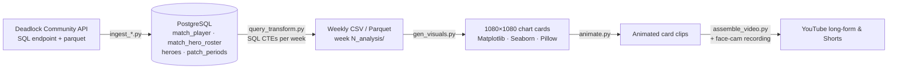

# Deadlock Ranked Analytics Pipeline

An end-to-end data pipeline that ingests every week of global **Deadlock** ranked matches,
stores them in PostgreSQL, transforms them with SQL, and renders publication-ready charts
for weekly YouTube analysis videos ([@eReys13](https://www.youtube.com/@eReys13)).

Each weekly run covers roughly **90,000 ranked matches** (about 1.1M player rows).

<!-- Add 2–3 of your best charts here, e.g.:


-->

## Pipeline



| Stage | Scripts | What it does |
|---|---|---|
| Discover | `db_table_schema_inspect.py` | Crawls the API's table list and per-table schemas (rate-limit aware) to decide what to ingest |
| Ingest | `ingest_dl_comm_api_parquet.py` (matches), `hero_ingest_deadlock.py`, `ingest_game_assets.py` (items, abilities, icons), `ingest_dl_comm_api_database.py`, `ingest_hero_icons.py` | Streams one week of ranked player rows from the API's parquet dump through DuckDB (date filter pushed down to the remote files), bulk-loads PostgreSQL via `COPY` into a staging table + `INSERT … ON CONFLICT` (idempotent re-runs), then rebuilds that week's team rosters from complete matches only. `--ranks-only --weeks 1-13` backfills just the rank columns of rows already loaded (see below) |
| Validate | `validate_week.py` | Data-quality gate: unknown heroes, incomplete matches, inconsistent winners, duplicate heroes, duration mismatches, roster coverage. Non-zero exit stops the pipeline |
| Transform | `query_transform.py` | Stages the week's complete matches once in temp tables, then runs every export against them (win rates, duo synergies, archetype differentials and matchups, duration histograms, comp frequency) |
| Orchestrate | `run_pipeline.py`, `register_period.py` | Runs heroes → ingest → validate → transform → charts → insights for a week or a registered patch/release period; stops at the first failing stage and can resume with `--from` |
| Visualize | `gen_visuals.py` + one script per chart, `animate.py` | Renders every chart for the target week as 1080×1080 cards; `animate.py` turns any card into a video clip (build-in, hold, highlight beats) piped to ffmpeg |
| Patch notes | `patch_notes.py` | Parses a balance patch (API feed, link or text file) into one row per change with a buff / nerf / rework call and the % size of the change; you correct the calls in `changes.csv` (and whole-hero / item calls in `overall.csv`), it learns from your corrections, then renders opener, overview, size, per-hero, per-item-slot, general and winners & losers cards |
| Video assembly | `assemble_video.py`, `orders/*.txt` | Cuts a face-cam recording by a LosslessCut segment CSV (one segment per card), renders each card's animation to the length of its take, composites face + card at 2560×1440, joins the segments (stream copy), writes YouTube chapters and renders 9:16 shorts for flagged segments. Segment order and chapter titles come from an order file (`orders/patch_notes.txt` preset, or an `order.txt` per video) |
| Insights | `insights.py` | Each chart script reports its findings as data (effect size + confidence); builds a running order per video (meta report weekly; game length / teams and the class deep dives rotating) with findings ranked per card, plus a rotating hero-spotlight video (one card per hero from `hero_spotlight.py`: trend, game length, partners; the roster split into four fixed groups) and a shorts list. Writes an outline and a matching `animate.py` scenes CSV for each into `plans/` |
| Shared | `db_config.py`, `pipeline_common.py`, `theme.py`, `chart_stats.py` | DB settings from env (UTC sessions); schema, week math and bulk-load helpers; card layout & palette; statistics (Wilson CIs, sample thresholds, pick rate) |

## Data model

The source is the community API's ClickHouse warehouse, discovered with
`db_table_schema_inspect.py`. Its `match_player` table is very wide (~170 columns, including
nested arrays for per-minute stats, items, deaths and objectives). The pipeline keeps only what
the analyses need, flattened into five local PostgreSQL tables:

| Local table | Grain | Key columns |
|---|---|---|
| `match_player` | one row per player per match | `match_id`, `account_id`, `hero_id`, `team`, `won`, `start_time`, `duration_s`, `average_badge` (match rank) and `player_rank` (the player's own rank going in), the player's rank progress (see below), ~20 end-of-match stats (kills, net worth, damage, healing…) |
| `match_hero_roster` | one row per match | `team0` / `team1` hero-id arrays, `winning_team`, `match_duration_s` |
| `heroes` | one row per hero | `hero_id`, `name`, `hero_type` (archetype) |
| `match_bans` | one row per match with recorded bans | `match_id`, `start_time`, `banned_hero_ids` (3 per ranked match). Only matches whose replay the API processed have bans (about 15–50% a day); `validate_week.py` reports the weekly coverage |
| `patch_periods` | one row per analysis window | `period_name` (e.g. `Week_8`), `start_time`, `end_time` |
| `items`, `hero_abilities` | one row per item / per hero ability slot | names, slot, tier, cost, icons (from `ingest_game_assets.py`) |

Rank progress columns on `match_player` (from the API's `player_rank_*` fields), enough to follow
every player's season match by match and measure what demotion shields actually did:

| Column | Meaning |
|---|---|
| `rank_progress_initial` / `rank_progress_final` | ladder points going into / out of the match (1,000 per subrank step, 7 steps per tier, Eternus from 70,000) |
| `rank_change_desired` | what the match should have awarded before shields (±300, win-streak bonuses, ±150 / 0 cases) |
| `shield_consumed`, `shields_initial` | whether a demotion shield was used; shields held going in |
| `win_streak_initial`, `calibration_games` | win streak going in; placement games left (> 0 = placement match) |
| `rank_outcome` | Win / Loss / Penalized / NotScored … |

Points saved by a shield = `rank_change_desired − (rank_progress_final − rank_progress_initial)`.

Design choices:
- **Ranked matches only**, from the 2026-07-30 ranked launch onward.
- **Columns ordered and downcast by width** (BIGINT → INT → SMALLINT → BOOLEAN/VARCHAR) to reduce
  row padding; ~1.1M player rows per week.
- **`(match_id, account_id)` primary key** prevents duplicate player rows when a week is re-ingested.
- **`patch_periods`** lets every query target a week or patch by name instead of hard-coded dates.

## Analyses

- **Hero pick rate vs win rate**: quadrant scatter with a data-driven "balanced zone" (49–51% WR × interquartile pick-rate range)
- **Archetype stacking**: win rate when a team has +N more brawlers / marksmen / assassins / mystics than the enemy
- **Win rate by match duration**: which heroes scale into late game vs. fall off
- **Hero duo synergies**: most-played pairs and their win rates
- **Performance by rank**: best and worst heroes in each of four rank brackets, and per-class win-rate curves across all 11 ranks with a shrinkage-adjusted Initiate → Eternus net change (also on every hero spotlight)
- **Balance patches**: buffs / nerfs / reworks per hero and item, how big each change was, and the patch's biggest winners and losers
- **Team composition frequency**: how rarely exact 6-hero comps repeat
- **Win-rate distribution**: hero balance vs. an idealized curve

Statistical guardrails: 95% Wilson confidence intervals on win rates, minimum-sample thresholds
before a bucket is plotted, and metadata (week, match count, threshold) printed on every chart.

## Tech stack

Python · PostgreSQL · SQL (CTEs, window functions, `FILTER`, `UNNEST`) · SQLAlchemy · psycopg2 ·
pandas · NumPy · PyArrow · DuckDB · Matplotlib · Seaborn · Pillow · ffmpeg

## Running it

```bash
python -m venv .venv && source .venv/bin/activate
pip install -e .                # installs dependencies + makes db_config / pipeline_common importable
cp .env.example .env            # then fill in your PostgreSQL credentials

python scripts/run_pipeline.py                 # last completed week, end to end
python scripts/run_pipeline.py --week 12       # a specific week
python scripts/run_pipeline.py --week 12 --from transform   # resume after fixing a failed stage
```

### Patch and hero-release periods

Weeks stay the backbone (a consistent week-over-week series). For patch videos, periods are
anchored to the patch or release time and paired with the same-length period right before it,
which every chart and `insights.py` compares against.

`sync_patches.py` (the last pipeline stage) does this automatically: it reads the API's patch
feed (forum changelog + Steam news) and detects hero releases from the match data, stores each
post once, groups posts within 12 hours into one patch event (forum + Steam copies, hotfixes),
and registers periods for confirmed events. Anything it can't classify waits for review:

```bash
python scripts/ingest_scripts/sync_patches.py --list
python scripts/ingest_scripts/sync_patches.py --confirm 8 --name Patch_6_0 --description "October balance patch"
python scripts/ingest_scripts/sync_patches.py --ignore 7        # a news post, not a patch
```

Periods can also be registered by hand:

```bash
python scripts/ingest_scripts/register_period.py --releases                 # hero release times in your data
python scripts/ingest_scripts/register_period.py --release "Nurse Harrow"   # days 1-7 + the 7 days before
python scripts/ingest_scripts/register_period.py --name Patch_2026-09-29 --start "2026-09-29 20:25" --days 7
python scripts/run_pipeline.py --period Release_Nurse_Harrow_d1-7
```

Periods can be any length. Output goes to `<project>/<period name>/`, labeled on every card.

### Backfilling rank progress

Weeks ingested before the rank progress columns existed can be filled in without re-ingesting them.
`--ranks-only` reads only the rank columns, narrows the remote files by each week's `match_id` range
(taken from your database), reads the file list once for every week, and updates existing rows only:

```bash
python scripts/ingest_scripts/ingest_dl_comm_api_parquet.py --ranks-only --weeks 13     # try one week
python scripts/ingest_scripts/ingest_dl_comm_api_parquet.py --ranks-only --weeks 1-12
```

### Patch-notes videos

```bash
python scripts/matplot_scripts/patch_notes.py parse --latest     # -> patches/<date>_<name>/changes.csv + overall.csv
#   review: correct the `auto` column in changes.csv; overall.csv overrides a hero/item's overall
#   call (`overall`) and pins or blocks the closing card's picks (`closer`: 1-3 or no)
python scripts/matplot_scripts/patch_notes.py cards patches/<folder>/
python scripts/matplot_scripts/animate.py patches/<folder>/        # animated clips of the cards
```

### Assembling a video

Record yourself talking through the cards, mark one segment per card in LosslessCut (named after
the card, `| HOOK TEXT` to also make a short), export the segment CSV, then:

```bash
python scripts/matplot_scripts/assemble_video.py RECORDING.mp4 SEGMENTS.csv patches/<folder>/ \
    [--add closer.mp4]          # a separate whole recording, placed by its card name
    [--order NAME|FILE|csv]     # default: order.txt in the cards folder, the patch preset, or CSV order
```

An order file lists one group of cards per line in video order, `pattern | chapter title | a-z`
(`*` matches anything, `{name}` = the matched part of the card name, `a-z` sorts the group). See
`orders/patch_notes.txt`. Output: one 2560×1440 video, a YouTube chapters `.txt`, and the shorts.

Each stage also runs on its own (`--week N` or `--date YYYY-MM-DD`). Week N is the N-th
7-day block since the ranked launch on 2026-07-30, `[start, start + 7 days)` in UTC; running
for a date processes the last week completed before it. Outputs land in `week<N>_analysis/`
(CSVs, `period_meta.json`) and `week<N>_analysis/graphs/` (PNGs). Raw data and game art are
not committed; the ingest scripts recreate them.

## Roadmap

- [x] Week-over-week deltas and an automated tier list (power score: win-rate edge × meta presence)
- [x] `insights.py`: rank the week's findings by effect size × confidence
- [x] Animated chart renders piped to ffmpeg (`animate.py`)
- [x] Win rate by rank bracket and per-rank curves
- [x] Balance-patch cards with reviewable buff/nerf calls (`patch_notes.py`)
- [x] Recording + cards → finished video, chapters and shorts (`assemble_video.py`)
- [x] Per-player rank progress (shields, points, placements) in the ingest
- [ ] Season analysis: placement vs final rank, climb vs win rate, real shield usage vs the Monte Carlo sim
- [ ] Skill floor (low vs high rank) as a power-score input
- [ ] Items and ability order: counts-based aggregate tables pre-built in DuckDB (pick rate, win rate, purchase timing)
- [ ] pytest coverage for SQL transforms and stats helpers; GitHub Actions CI

## Data & attribution

Match data from the [Deadlock Community API](https://deadlock-api.com). Deadlock and its
hero art are property of Valve Corporation; this project is not affiliated with Valve.