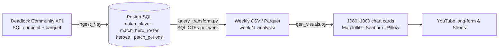

# Deadlock Ranked Analytics Pipeline

An end-to-end data pipeline that ingests every week of global **Deadlock** ranked matches,
stores them in PostgreSQL, transforms them with SQL, and renders publication-ready charts
for weekly YouTube analysis videos ([@eReys13](https://www.youtube.com/@eReys13)).

Each weekly run covers roughly **90,000 ranked matches** (about 1.1M player rows).

<!-- Add 2–3 of your best charts here, e.g.:


-->

## Pipeline



| Stage | Scripts | What it does |
|---|---|---|
| Discover | `db_table_schema_inspect.py` | Crawls the API's table list and per-table schemas (rate-limit aware) to decide what to ingest |
| Ingest | `ingest_dl_comm_api_parquet.py` (matches), `hero_ingest_deadlock.py`, `ingest_dl_comm_api_database.py` (items), `ingest_hero_icons.py` | Streams one week of ranked player rows from the API's parquet dump through DuckDB (date filter pushed down to the remote files), bulk-loads PostgreSQL via `COPY` into a staging table + `INSERT … ON CONFLICT` (idempotent re-runs), then rebuilds that week's team rosters from complete matches only |
| Validate | `validate_week.py` | Data-quality gate: unknown heroes, incomplete matches, inconsistent winners, duplicate heroes, duration mismatches, roster coverage. Non-zero exit stops the pipeline |
| Transform | `query_transform.py` | Stages the week's complete matches once in temp tables, then runs every export against them (win rates, duo synergies, archetype differentials and matchups, duration histograms, comp frequency) |
| Orchestrate | `run_pipeline.py` | Runs heroes → ingest → validate → transform → charts for a week; stops at the first failing stage and can resume with `--from` |
| Visualize | `gen_visuals.py` + one script per chart | Renders every chart for the target week |
| Shared | `db_config.py`, `pipeline_common.py`, `theme.py`, `chart_stats.py` | DB settings from env (UTC sessions); schema, week math and bulk-load helpers; card layout & palette; statistics (Wilson CIs, sample thresholds, pick rate) |

## Data model

The source is the community API's ClickHouse warehouse, discovered with
`db_table_schema_inspect.py`. Its `match_player` table is very wide (~170 columns, including
nested arrays for per-minute stats, items, deaths and objectives). The pipeline keeps only what
the analyses need, flattened into four local PostgreSQL tables:

| Local table | Grain | Key columns |
|---|---|---|
| `match_player` | one row per player per match | `match_id`, `account_id`, `hero_id`, `team`, `won`, `start_time`, `duration_s`, rank badges, ~20 **optional** end-of-match stats (kills, net worth, damage, healing…) |
| `match_hero_roster` | one row per match | `team0` / `team1` hero-id arrays, `winning_team`, `match_duration_s` |
| `heroes` | one row per hero | `hero_id`, `name`, `hero_type` (archetype) |
| `patch_periods` | one row per analysis window | `period_name` (e.g. `Week_8`), `start_time`, `end_time` |

Design choices:
- **Ranked matches only**, from the 2026-07-30 ranked launch onward.
- **Columns ordered and downcast by width** (BIGINT → INT → SMALLINT → BOOLEAN/VARCHAR) to reduce
  row padding; ~1.1M player rows per week.
- **`(match_id, account_id)` primary key** prevents duplicate player rows when a week is re-ingested.
- **`patch_periods`** lets every query target a week or patch by name instead of hard-coded dates.

## Analyses

- **Hero pick rate vs win rate**: quadrant scatter with a data-driven "balanced zone" (49–51% WR × interquartile pick-rate range)
- **Archetype stacking**: win rate when a team has +N more brawlers / marksmen / assassins / mystics than the enemy
- **Win rate by match duration**: which heroes scale into late game vs. fall off
- **Hero duo synergies**: most-played pairs and their win rates
- **Team composition frequency**: how rarely exact 6-hero comps repeat
- **Win-rate distribution**: hero balance vs. an idealized curve

Statistical guardrails: 95% Wilson confidence intervals on win rates, minimum-sample thresholds
before a bucket is plotted, and metadata (week, match count, threshold) printed on every chart.

## Tech stack

Python · PostgreSQL · SQL (CTEs, window functions, `FILTER`, `UNNEST`) · SQLAlchemy · psycopg2 ·
pandas · NumPy · PyArrow · Matplotlib · Seaborn · Pillow

## Running it

```bash
python -m venv .venv && source .venv/bin/activate
pip install -e .                # installs dependencies + makes db_config / pipeline_common importable
cp .env.example .env            # then fill in your PostgreSQL credentials

python scripts/run_pipeline.py                 # last completed week, end to end
python scripts/run_pipeline.py --week 12       # a specific week
python scripts/run_pipeline.py --week 12 --from transform   # resume after fixing a failed stage
```

Each stage also runs on its own (`--week N` or `--date YYYY-MM-DD`). Week N is the N-th
7-day block since the ranked launch on 2026-07-30, `[start, start + 7 days)` in UTC; running
for a date processes the last week completed before it. Outputs land in `week<N>_analysis/`
(CSVs, `period_meta.json`) and `week<N>_analysis/graphs/` (PNGs). Raw data and game art are
not committed; the ingest scripts recreate them.

## Roadmap

- [ ] Week-over-week deltas and an automated tier list
- [ ] `insights.py`: rank the week's findings by effect size × confidence
- [ ] Animated chart renders (every chart already takes a `progress` parameter) piped to ffmpeg
- [ ] pytest coverage for SQL transforms and stats helpers; GitHub Actions CI

## Data & attribution

Match data from the [Deadlock Community API](https://deadlock-api.com). Deadlock and its
hero art are property of Valve Corporation; this project is not affiliated with Valve.